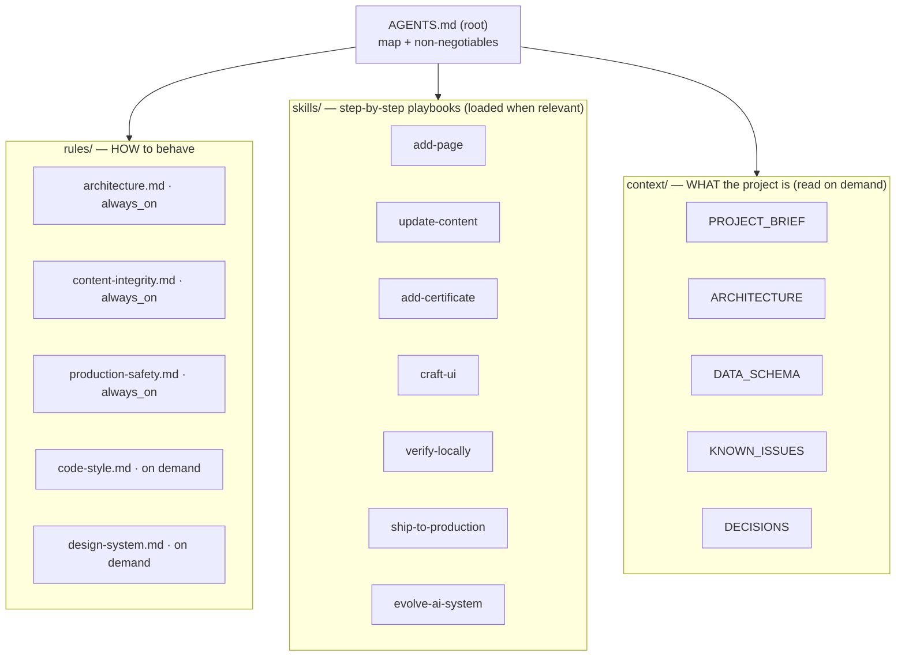

# `.agents/` — AI Context System

This folder is how AI agents learn this project. Antigravity auto-discovers it; other tools (Codex, Cursor, Claude Code, Copilot) reach it through the root [`AGENTS.md`](../AGENTS.md).

## How it loads



| Layer | Purpose | Loaded |
|---|---|---|
| `AGENTS.md` | Entry point: what, where, hard rules | Always |
| `rules/` | Constraints. Short, imperative. | `always_on` every turn; `model_decision` when topic matches |
| `skills/` | Procedures with exact files + commands + verification | Only name/description up front; body when the task matches |
| `context/` | Facts about the codebase and project | When an agent follows a link |

Why split it this way: always-loaded text costs context on every turn, so only damage-preventing rules are always-on. Everything else loads when it's needed.

## Tree

```text
AGENTS.md
.agents/
├── README.md                     ← you are here
├── rules/
│   ├── architecture.md           no build, globals, script order, view contract
│   ├── content-integrity.md      never fabricate; verified vs unverified content
│   ├── production-safety.md      main = live; approval gates; commits
│   ├── code-style.md             JS/CSS/HTML conventions
│   └── design-system.md          tokens, type, motion, anti-slop checklist
├── skills/
│   ├── add-page/                 new route, all 7 touch points
│   ├── update-content/           edit content + keep duplicated copies in sync
│   ├── add-certificate/          new cert/badge + assets + filter category
│   ├── craft-ui/                 design process + self-critique
│   ├── verify-locally/           check script, local server, browser checklist
│   │   └── scripts/check.mjs     zero-dependency static checker
│   ├── ship-to-production/       commit, preview branch, deploy (approval-gated)
│   └── evolve-ai-system/         how to grow/maintain this folder
└── context/
    ├── PROJECT_BRIEF.md          owner, audience, goals, voice, feature list
    ├── ARCHITECTURE.md           boot sequence, router, global API, CSS layers
    ├── DATA_SCHEMA.md            every data field + duplication map
    ├── KNOWN_ISSUES.md           audit findings, prioritized
    └── DECISIONS.md              why things are the way they are
```

## Using it (for humans)

- Starting a session: nothing to do — it loads automatically. To force a skill, mention it: *"use the add-certificate skill"*.
- Agent made a mistake? Tell it: *"add a rule so this doesn't happen again"* → it uses `evolve-ai-system`.
- Health check anytime: `node .agents/skills/verify-locally/scripts/check.mjs`

## Scaling it

New recurring task → new skill folder. New constraint → line in the closest rule file. See [`skills/evolve-ai-system/SKILL.md`](skills/evolve-ai-system/SKILL.md).
