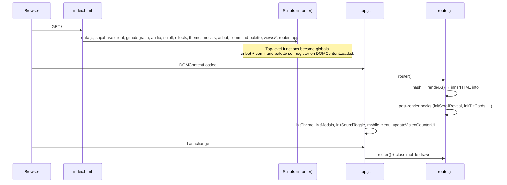

# Architecture

## Boot sequence



## Routing (`src/js/router.js`)

1. `hash = location.hash || '#/'`
2. Prefix routes first: `#/shop/<id>` → `renderShopDetail(item)`, `#/projects/<id>` → `renderProjectDetail(project)`, `#/blog/<id>` → `renderBlogDetail(post)` (looked up in `portfolioData`).
3. Otherwise `routes[hash]`. Unknown `#/...` falls back to `renderHome`.
4. A hash NOT starting with `#/` (e.g. `#certifications`) renders Home and smooth-scrolls to that element ID.
5. If the view changed: add `page-exit`, wait 200 ms, swap `innerHTML`, add `page-enter`, scroll to top, run hooks:

```js
initScrollReveal(); initTiltCards(); initMagnetic(); initProjectsStack();
initVerifiedBadgeConfetti(); initAudioLoungeEvents() /* only on #/audio */; playSound('nav');
```

6. Sidebar `a.active` is set by matching hash or parent view (`viewHash`), with hash anchors (e.g. `#certifications`) maintaining Home activation. Detail views (`#/projects/:id`, `#/shop/:id`, `#/blog/:id`) keep their parent nav links active.

**Implication:** a hook runs on every page, so each `initX` must no-op when its elements are absent (`if (!el) return;`).

### Route table

| Hash | Render fn | File |
|---|---|---|
| `#/` | `renderHome` | `views/home.js` |
| `#/projects` · `#/projects/:id` | `renderProjectsAll` · `renderProjectDetail` | `views/projects-all.js` · `views/project-detail.js` |
| `#/experience` | `renderExperienceAll` | `views/experience-all.js` |
| `#/stack` | `renderStackAll` | `views/stack-all.js` |
| `#/certifications` | `renderCertificationsAll` | `views/certifications-all.js` |
| `#/recommendations` | `renderRecommendationsAll` | `views/recommendations-all.js` |
| `#/shop` · `#/shop/:id` | `renderShop` · `renderShopDetail` | `views/shop.js` · `views/shop-detail.js` |
| `#/blog` · `#/blog/:id` | `renderBlog` · `renderBlogDetail` | `views/blog.js` · `views/blog-detail.js` |
| `#/gear` | `renderGear` | `views/gear.js` |
| `#/resources` | `renderResources` | `views/resources.js` |
| `#/collabs` | `renderCollabs` | `views/collabs.js` |
| `#/consulting` | `renderConsulting` | `views/consulting.js` |
| `#/audio` | `renderAudioLounge` | `views/audio-lounge.js` |
| `#/cyber-lab` | `renderCyberLab` | `views/cyber-lab.js` |
| `#/affiliations` | *(none — falls back to Home, no scroll)* | — |

## Global API surface (what other files call)

| Global | Defined in | Used by |
|---|---|---|
| `portfolioData` | `data.js` | views, router |
| `router`, `getCurrentView` | `router.js` | `app.js`, `theme.js` |
| `playSound(type)` | `audio.js` | almost everything |
| `toggleSoundscapes`, `setSoundscape(mode)`, `set*Volume`, `initSoundToggle` | `audio.js` | sidebar, command palette, audio lounge |
| `audioPlaylist`, `activeTrackId`, `isPlayingTrack`, `visualizerMode` | `audio.js` / `audio-lounge.js` | audio lounge |
| `initScrollReveal` | `scroll.js` | router |
| `initTiltCards`, `initMagnetic`, `initProjectsStack`, `initVerifiedBadgeConfetti` | `effects.js` | router |
| `initTheme` | `theme.js` | `app.js` |
| `initModals`, `openModal`, `closeModal`, terminal/typing/community modals | `modals.js` | `app.js`, keyboard shortcuts |
| `initAIBot` | `ai-bot.js` | self (DOMContentLoaded) |
| `initCommandPalette`, `commandItems` | `command-palette.js` | self (DOMContentLoaded) |
| `generateGithubGraph` | `components/github-graph.js` | `home.js` |
| `initAudioLoungeEvents`, Pomodoro fns | `audio-lounge.js` | router |
| `renderCyberLab`, `initCyberLabEvents` | `cyber-lab.js` | router |
| `renderBlog`, `initBlogListEvents`, `renderBlogDetail`, `initBlogDetailEvents` | `blog.js` · `blog-detail.js` | router |
| `getSupabaseClient`, `openContactModal`, `closeContactModal`, `openGuestbookModal`, `closeGuestbookModal`, `submitContactMessage`, `submitGuestbookEntry`, `updateVisitorCounterUI` | `supabase-client.js` | `app.js`, sidebar, home, command palette |

## Keyboard shortcuts

| Keys | Action | Defined in |
|---|---|---|
| Ctrl/Cmd + K | Command palette | `command-palette.js` |
| Alt + K | Terminal modal ("Ask anything" button label) | `modals.js` |
| Alt + J | Typing test | `modals.js` |
| Esc | Close palette/modals/contact & guestbook | `command-palette.js`, `modals.js`, `supabase-client.js` |

## CSS architecture

`main.css` → `tokens.css` (vars, reset) → `layout.css` (shell, sidebar, mobile header) → `components.css` (buttons, cards, modals, AI widget, palette, confetti) → `views.css` (modular index importing `src/css/views/*.css`: `home`, `projects`, `experience`, `stack`, `certifications`, `recommendations`, `shop`, `blog`, `audio`, `cyber-lab`, `misc`, `responsive`) → `animations.css` (keyframes, reveal, page transitions).

Theme switch = `data-theme` attribute on `<html>`; all colors flow from tokens.

## Deployment

Static files → Vercel. `vercel.json`: `{ "version": 2, "cleanUrls": true }`. No build command, output dir = repo root. Push to `main` → production.
