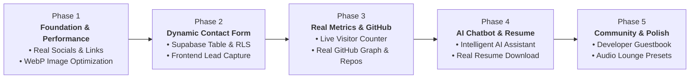

# Enhancement Roadmap: Phase-by-Phase Execution Plan

> Strategic, step-by-step development roadmap for upgrading [roldangaspar.vercel.app](https://roldangaspar.vercel.app) from a static template to an authentic, high-performance, dynamic developer portfolio.

---

## 🗺️ Roadmap Architecture Overview

---

## 📋 Phase 1: Foundation, Credibility & Performance `[COMPLETED ✅ - Commit dccccb9]`
**Goal:** Fix credibility issues, remove broken `#` links, and cut initial load size by >90%.

### Scope of Work
1. **Real Socials & Contact Links:**
   - Replaced all `href="#"` in Hero (`home.js`) and Sidebar (`index.html`) with real URLs (GitHub, LinkedIn, Email).
   - Fixed broken affiliations links (`#/affiliations`) and community links.
2. **Hero Image Optimization (`MyPic.png`):**
   - Converted 2.9 MB PNG to 34 KB WebP (98.8% bandwidth reduction).
3. **Favicon & Meta Tags:**
   - Added rich Open Graph and Twitter card preview metadata for social sharing.

---

## 📋 Phase 2: Dynamic Contact Form & Lead Generation `[COMPLETED ✅ - Commit acbb060]`
**Goal:** Allow recruiters, hiring managers, and clients to send direct messages stored in Supabase.

### Scope of Work
1. **Supabase Database Architecture:**
   - Created `public.contact_messages` table with PostgreSQL Row Level Security (RLS).
   - Only `INSERT` allowed for `anon`; public `SELECT` strictly disabled for complete privacy.
2. **Frontend UI Implementation:**
   - Modern glassmorphic Contact Modal with 4 inquiry categories (Hiring, Consulting, Collab, General).
   - Dedicated sidebar contact button and command palette integration (`Alt + K` -> "Send a Message").
   - Integrated with existing Web Audio sound engine (`playSound('open')`, `playSound('click')`).
3. **Client Integration (`src/js/utils/supabase-client.js`):**
   - Supabase v2 client library loaded from CDN.
   - Handled error states, field validation, and responsive mobile styling.
   - Verified live in production at [roldangaspar.vercel.app](https://roldangaspar.vercel.app).

---

## 📋 Phase 3: Real Metrics & Real GitHub Integration `[COMPLETED ✅ - Commit 843ab73]`
**Goal:** Replace placeholder counters and fake random green dots with real live data.

### Scope of Work
1. **Real Live Visitor Counter:**
   - Replaced hardcoded fake `"16 people viewing now"` and `+13` fake avatars with a real Supabase atomic counter.
   - Built table `public.site_metrics` and atomic PostgreSQL RPC function `increment_site_views()` with session caching.
   - Live formatted counter and pulsing status indicator displayed in the sidebar.
2. **Real GitHub Contribution Graph & Featured Repositories:**
   - Replaced fake `Math.random()` random dots with authentic 365-day contribution calendar synced from GitHub API for user `RoldanGaspar`.
   - Replaced static placeholder numbers with verified dynamic contribution totals (`105+`).
   - Added Featured Open-Source Repositories grid displaying Roldan's verified projects (`Portfolio_Brylim_inspo`, `AWarden-A-applocker_credentials`, `pos_with_inventory_system`, `pet-hub-payroll`) with language badges and live star counts.
   - Verified live in production at [roldangaspar.vercel.app](https://roldangaspar.vercel.app).

---

## 📋 Phase 4: AI Chatbot & Resume Asset Upgrades
**Goal:** Upgrade the portfolio's AI assistant from simple keyword matching to an intelligent companion, and make resumes downloadable.

### Scope of Work
1. **Intelligent "Ask AI" Assistant Upgrade:**
   - Current: `ai-bot.js` uses simple `if (query.includes('skill'))` string checks.
   - Upgrade: Expand knowledge base with verified Cisco NetAcad certificates, technical stack, career interests, and consultation details. Provide smart suggestions and quick-action chips.
2. **Working ATS Resume Downloader:**
   - Replace `downloadUrl: "#"` in `data.js` and `#/shop/developer-resume-template`.
   - Provide a clean, downloadable PDF/DOCX developer resume asset in `assets/resume/`.

### Operating Standards
* **Rules to Follow:**
  - [`content-integrity.md`](../rules/content-integrity.md) — Bot answers must never invent achievements, jobs, or metrics.
  - [`code-style.md`](../rules/code-style.md) — User inputs rendered via `textContent` to prevent XSS.
* **Skills to Use:**
  - [`update-content`](../skills/update-content/SKILL.md) — Sync chatbot knowledge with `portfolioData`.
  - [`craft-ui`](../skills/craft-ui/SKILL.md) — Improve chat drawer responsiveness on mobile screens.
* **MCP Tools:** `github`, `vercel`.

---

## 📋 Phase 5: Community Features & Audio Lounge Polish
**Goal:** Foster engagement through an interactive guestbook and audio synthesizer polish.

### Scope of Work
1. **Interactive Developer Guestbook:**
   - Allow fellow developers and visitors to leave a verified message or greeting.
   - Moderate entries via Supabase dashboard / status flag (`is_approved`).
2. **Web Audio Lounge Expansion (`#/audio`):**
   - Add new procedural soundscapes or binaural beats for focus/coding.
   - Enhance the canvas visualizer with responsive frame sizing.

### Operating Standards
* **Rules to Follow:**
  - [`mcp-safety.md`](../rules/mcp-safety.md) — Strict RLS: public `SELECT` restricted to `is_approved = true`.
  - [`design-system.md`](../rules/design-system.md) — Dark chassis theme preservation, keyboard accessibility.
* **Skills to Use:**
  - [`manage-supabase`](../skills/manage-supabase/SKILL.md) — Guestbook table and moderation queries.
  - [`craft-ui`](../skills/craft-ui/SKILL.md) — Audio controls and message feed layout.
* **MCP Tools:** `supabase`, `github`, `vercel`.

---

## 🚦 Execution Protocol for Every Phase

Every phase must strictly follow this 5-step engineering loop:

1. **Plan & Align:** Define specific files and DDL schemas before modifying code.
2. **Build with Standards:** Follow design tokens, classic script conventions, and RLS rules.
3. **Verify Locally:** Execute `node .agents/skills/verify-locally/scripts/check.mjs` (must pass with `0 errors`).
4. **Commit & Push:** Use Conventional Commits (`feat(...)`, `fix(...)`) and push via GitHub MCP.
5. **Production Verification:** Inspect Vercel MCP deployment logs to confirm live status at [roldangaspar.vercel.app](https://roldangaspar.vercel.app).
