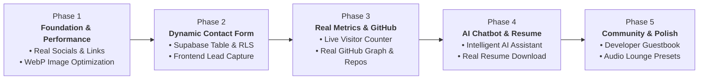

# Enhancement Roadmap: Phase-by-Phase Execution Plan

> Strategic, step-by-step development roadmap for upgrading [roldangaspar.vercel.app](https://roldangaspar.vercel.app) from a static template to an authentic, high-performance, dynamic developer portfolio.

---

## 🗺️ Roadmap Architecture Overview

---

## 📋 Phase 1: Foundation, Credibility & Performance
**Goal:** Fix credibility issues, remove broken `#` links, and cut initial load size by >90%.

### Scope of Work
1. **Real Socials & Contact Links:**
   - Replace all `href="#"` in Hero (`home.js`) and Sidebar (`index.html`) with real URLs (GitHub, LinkedIn, Email).
   - Fix broken affiliations links (`#/affiliations`) and community links.
2. **Hero Image Optimization (`MyPic.png`):**
   - Current: 2.9 MB PNG (slow on mobile).
   - Target: Compressed WebP format (< 100 KB) + high-res crispness, maintaining aspect ratio.
3. **Favicon & Meta Tags:**
   - Add `<meta name="description">`, Open Graph (OG), and Twitter card tags for professional link previews on LinkedIn/X.

### Operating Standards
* **Rules to Follow:**
  - [`content-integrity.md`](../rules/content-integrity.md) — Only use Roldan's verified social profiles and email.
  - [`production-safety.md`](../rules/production-safety.md) — Verify all links work locally before pushing to `main`.
* **Skills to Use:**
  - [`update-content`](../skills/update-content/SKILL.md) — Update data and markup consistently.
  - [`verify-locally`](../skills/verify-locally/SKILL.md) — Run `check.mjs` to ensure 0 broken links.
  - [`ship-to-production`](../skills/ship-to-production/SKILL.md) — Commit and deploy to Vercel.
* **MCP Tools:** `github` (commit & push), `vercel` (verify build status).

---

## 📋 Phase 2: Dynamic Contact Form & Lead Generation
**Goal:** Allow recruiters, hiring managers, and clients to send direct messages stored in Supabase.

### Scope of Work
1. **Supabase Database Architecture:**
   - Table: `public.contact_messages` (`id`, `created_at`, `name`, `email`, `subject`, `message`, `status`).
   - Security: Enable Row Level Security (RLS) allowing public `anon` users to `INSERT` only. Public `SELECT` is forbidden.
2. **Frontend UI Implementation:**
   - Add a sleek modal or dedicated `#*/contact*` view matching the glassmorphic design system.
   - Form fields: Name, Email, Subject/Inquiry Type (Hire, Collab, Consulting), Message.
   - Interactive feedback: Web Audio chime on submit + floating success toast.
3. **Client Integration (`src/js/utils/supabase-client.js`):**
   - Load Supabase JS CDN script in `index.html`.
   - Wire async form submission with input sanitization and error states.

### Operating Standards
* **Rules to Follow:**
  - [`mcp-safety.md`](../rules/mcp-safety.md) — Never expose `service_role` keys in client code; enforce RLS.
  - [`design-system.md`](../rules/design-system.md) — Use tokens (`--card-bg`, `--border-color`, `--accent-blue`), support light/dark themes.
  - [`architecture.md`](../rules/architecture.md) — No npm packages, classic script tags sharing globals.
* **Skills to Use:**
  - [`manage-supabase`](../skills/manage-supabase/SKILL.md) — Execute DDL migrations and verify policies.
  - [`craft-ui`](../skills/craft-ui/SKILL.md) — Build accessible, responsive form UI.
* **MCP Tools:** `supabase` (DDL & table setup), `github` (push), `vercel` (deploy).

---

## 📋 Phase 3: Real Metrics & Real GitHub Integration
**Goal:** Replace placeholder counters and fake random green dots with real live data.

### Scope of Work
1. **Real Live Visitor Counter:**
   - Replace the hardcoded `"16 people viewing now"` and `"+13 avatars"` with a real Supabase atomic counter.
   - Call a PostgreSQL RPC function (`increment_page_view()`) on initial load.
2. **Real GitHub Contribution Graph & Pinned Repos:**
   - Current: `components/github-graph.js` generates random green dots using `Math.random()`.
   - Upgrade: Connect to GitHub REST API to display real public contribution activity or showcase real repositories with live commit timestamps and stars.

### Operating Standards
* **Rules to Follow:**
  - [`content-integrity.md`](../rules/content-integrity.md) — Real data only; no fabricated numbers or stats.
  - [`code-style.md`](../rules/code-style.md) — Guard DOM lookups, sanitize API outputs before rendering.
* **Skills to Use:**
  - [`manage-supabase`](../skills/manage-supabase/SKILL.md) — Set up view counters and RPC functions.
  - [`craft-ui`](../skills/craft-ui/SKILL.md) — Refine graph and stats bar styling for both themes.
* **MCP Tools:** `github` (fetch repo details/activity), `supabase` (analytics table).

---

## 📋 Phase 4: AI Chatbot & Resume Asset Upgrades
**Goal:** Upgrade the portfolio's AI assistant from simple keyword matching to an intelligent companion, and make resumes downloadable.

### Scope of Work
1. **Intelligent "Ask AI" Assistant Upgrade:**
   - Current: `ai-bot.js` uses simple `if (query.includes('skill'))` string checks.
   - Upgrade: Expand knowledge base with verified Cisco NetAcad certificates, technical stack, career interests, and consultation details. Provide smart suggestions and quick-action chips.
2. **Working ATS Resume Downloader:**
   - Replace `downloadUrl: "#"` in `data.js` and `#/shop/developer-resume-template`.
   - Provide a clean, downloadable PDF/DOCX developer resume asset in `assets/resume/`.

### Operating Standards
* **Rules to Follow:**
  - [`content-integrity.md`](../rules/content-integrity.md) — Bot answers must never invent achievements, jobs, or metrics.
  - [`code-style.md`](../rules/code-style.md) — User inputs rendered via `textContent` to prevent XSS.
* **Skills to Use:**
  - [`update-content`](../skills/update-content/SKILL.md) — Sync chatbot knowledge with `portfolioData`.
  - [`craft-ui`](../skills/craft-ui/SKILL.md) — Improve chat drawer responsiveness on mobile screens.
* **MCP Tools:** `github`, `vercel`.

---

## 📋 Phase 5: Community Features & Audio Lounge Polish
**Goal:** Foster engagement through an interactive guestbook and audio synthesizer polish.

### Scope of Work
1. **Interactive Developer Guestbook:**
   - Allow fellow developers and visitors to leave a verified message or greeting.
   - Moderate entries via Supabase dashboard / status flag (`is_approved`).
2. **Web Audio Lounge Expansion (`#/audio`):**
   - Add new procedural soundscapes or binaural beats for focus/coding.
   - Enhance the canvas visualizer with responsive frame sizing.

### Operating Standards
* **Rules to Follow:**
  - [`mcp-safety.md`](../rules/mcp-safety.md) — Strict RLS: public `SELECT` restricted to `is_approved = true`.
  - [`design-system.md`](../rules/design-system.md) — Dark chassis theme preservation, keyboard accessibility.
* **Skills to Use:**
  - [`manage-supabase`](../skills/manage-supabase/SKILL.md) — Guestbook table and moderation queries.
  - [`craft-ui`](../skills/craft-ui/SKILL.md) — Audio controls and message feed layout.
* **MCP Tools:** `supabase`, `github`, `vercel`.

---

## 🚦 Execution Protocol for Every Phase

Every phase must strictly follow this 5-step engineering loop:

1. **Plan & Align:** Define specific files and DDL schemas before modifying code.
2. **Build with Standards:** Follow design tokens, classic script conventions, and RLS rules.
3. **Verify Locally:** Execute `node .agents/skills/verify-locally/scripts/check.mjs` (must pass with `0 errors`).
4. **Commit & Push:** Use Conventional Commits (`feat(...)`, `fix(...)`) and push via GitHub MCP.
5. **Production Verification:** Inspect Vercel MCP deployment logs to confirm live status at [roldangaspar.vercel.app](https://roldangaspar.vercel.app).
