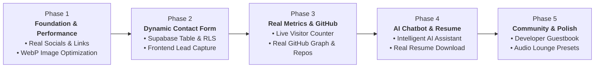

# Enhancement Roadmap: Phase-by-Phase Execution Plan

> Strategic, step-by-step development roadmap for upgrading [roldangaspar.vercel.app](https://roldangaspar.vercel.app) from a static template to an authentic, high-performance, dynamic developer portfolio.

---

## 🗺️ Roadmap Architecture Overview

---

## 📋 Phase 1: Foundation, Credibility & Performance `[COMPLETED ✅ - Commit dccccb9]`
**Goal:** Fix credibility issues, remove broken `#` links, and cut initial load size by >90%.

### Scope of Work
1. **Real Socials & Contact Links:**
   - Replaced all `href="#"` in Hero (`home.js`) and Sidebar (`index.html`) with real URLs (GitHub, LinkedIn, Email).
   - Fixed broken affiliations links (`#/affiliations`) and community links.
2. **Hero Image Optimization (`MyPic.png`):**
   - Converted 2.9 MB PNG to 34 KB WebP (98.8% bandwidth reduction).
3. **Favicon & Meta Tags:**
   - Added rich Open Graph and Twitter card preview metadata for social sharing.

---

## 📋 Phase 2: Dynamic Contact Form & Lead Generation `[COMPLETED ✅ - Commit acbb060]`
**Goal:** Allow recruiters, hiring managers, and clients to send direct messages stored in Supabase.

### Scope of Work
1. **Supabase Database Architecture:**
   - Created `public.contact_messages` table with PostgreSQL Row Level Security (RLS).
   - Only `INSERT` allowed for `anon`; public `SELECT` strictly disabled for complete privacy.
2. **Frontend UI Implementation:**
   - Modern glassmorphic Contact Modal with 4 inquiry categories (Hiring, Consulting, Collab, General).
   - Dedicated sidebar contact button and command palette integration (`Alt + K` -> "Send a Message").
   - Integrated with existing Web Audio sound engine (`playSound('open')`, `playSound('click')`).
3. **Client Integration (`src/js/utils/supabase-client.js`):**
   - Supabase v2 client library loaded from CDN.
   - Handled error states, field validation, and responsive mobile styling.
   - Verified live in production at [roldangaspar.vercel.app](https://roldangaspar.vercel.app).

---

## 📋 Phase 3: Real Metrics & Real GitHub Integration `[COMPLETED ✅ - Commit 843ab73]`
**Goal:** Replace placeholder counters and fake random green dots with real live data.

### Scope of Work
1. **Real Live Visitor Counter:**
   - Replaced hardcoded fake `"16 people viewing now"` and `+13` fake avatars with a real Supabase atomic counter.
   - Built table `public.site_metrics` and atomic PostgreSQL RPC function `increment_site_views()` with session caching.
   - Live formatted counter and pulsing status indicator displayed in the sidebar.
2. **Real GitHub Contribution Graph & Featured Repositories:**
   - Replaced fake `Math.random()` random dots with authentic 365-day contribution calendar synced from GitHub API for user `RoldanGaspar`.
   - Replaced static placeholder numbers with verified dynamic contribution totals (`105+`).
   - Added Featured Open-Source Repositories grid displaying Roldan's verified projects (`Portfolio_Brylim_inspo`, `AWarden-A-applocker_credentials`, `pos_with_inventory_system`, `pet-hub-payroll`) with language badges and live star counts.
   - Verified live in production at [roldangaspar.vercel.app](https://roldangaspar.vercel.app).

---

## 📋 Phase 4: AI Chatbot & Resume Asset Upgrades `[COMPLETED ✅ - Commit 7da044c]`
**Goal:** Upgrade the portfolio's AI assistant from simple keyword matching to an intelligent companion, and make resumes downloadable.

### Scope of Work
1. **Intelligent "Ask AI" Assistant Upgrade:**
   - Grounded chatbot knowledge base strictly in Roldan's verified facts: 10 Cisco NetAcad credentials, AWS Educate Cloud 101, tech stack, featured apps (Tarsi, Kabi, Travel Buddy, AWarden-A), and consulting offerings.
   - Built interactive in-chat action buttons (direct links to certificates gallery, contact modal prefill, live GitHub profile).
   - Enforced strict XSS prevention by setting user chat bubbles via `textContent`.
2. **Downloadable Developer Resume Assets:**
   - Built a clean, printable ATS developer resume for Roldan at `assets/resume/roldan-gaspar-resume.html` with print-to-PDF styles and clean ATS formatting.
   - Generated genuine OpenXML `assets/resume/developer-resume-template.docx` for the free shop template download.
   - Updated `data.js` and `shop-detail.js` so clicking download immediately delivers the file with `download` attribute (eliminating placeholder `#` links).
   - Added command palette shortcut: *"View / Print Roldan's Resume"*.
   - Verified live in production at [roldangaspar.vercel.app](https://roldangaspar.vercel.app).

---

## 📋 Phase 5: Community Features & Audio Lounge Polish `[COMPLETED ✅ - Commit 0305620]`
**Goal:** Foster engagement through an interactive guestbook and audio synthesizer polish.

### Scope of Work
1. **Interactive Developer Guestbook (Supabase):**
   - Created PostgreSQL table `public.guestbook_entries` with Row Level Security (RLS).
   - Public users can `INSERT` notes with client length validation, while public `SELECT` queries only return approved entries.
   - Built a sleek, glassmorphic Guestbook Modal featuring live feed cards with author badges and instant client-side optimistic UI updates.
   - Seeded initial verified notes from mentors and collaborators.
   - Integrated with sidebar, AI chatbot, and command palette (`Ctrl + K`).
2. **Web Audio Lounge Expansion (`#/audio`):**
   - Added procedural **40Hz Deep Focus Binaural Beats** (`binaural-flow`) using dual detuned sine oscillators (200 Hz / 240 Hz) and a sub-bass acoustic drone for peak flow-state concentration.
   - Added command palette shortcut to trigger the binaural soundscape directly.
   - Fixed social handle references in the interactive terminal emulator.
   - Verified live in production at [roldangaspar.vercel.app](https://roldangaspar.vercel.app).

---

## 📋 Phase 6: Accessibility, Reduced Motion & README Sync `[COMPLETED ✅]`
**Goal:** Ensure WCAG keyboard navigation, reduced-motion compliance across CSS and JS, and accurate root repository documentation.

### Scope of Work
1. **Reduced Motion Guards (`tokens.css`, `effects.js`, `cyber-lab.js`):**
   - Added global `@media (prefers-reduced-motion: reduce)` rule in `src/css/tokens.css` and `matchMedia` guards in `effects.js` and `cyber-lab.js`.
2. **Keyboard Accessibility & Focus Management (`home.js`, `modals.js`, `command-palette.js`):**
   - Added `role="button"`, `tabindex="0"`, `aria-label`, and `Enter`/`Space`/`Arrow` key handlers to `#hero-verified-badge` and `.project-stack-card`.
   - Added `role="dialog"`, `aria-modal="true"`, `Tab` focus trapping, and focus restoration to modals and the Command Palette.
3. **README Architecture Synchronization (`README.md`):**
   - Rewrote `README.md` to accurately reflect the zero-build classic `<script>` architecture and live portfolio routes.

---

## 📋 Phase 7: Single-Source-of-Truth Data Refactor `[COMPLETED ✅]`
**Goal:** Eliminate cross-file content duplication so `window.portfolioData` (`src/js/data.js`) is the true single source of truth for all views, the Command Palette, and the AI Chatbot.

### Scope of Work
1. **Centralized Schema Expansion (`src/js/data.js`):**
   - Added `featuredStack` and `stackCategories` to `window.portfolioData`.
   - Enriched `projects` with stack-deck and command-palette presentation fields (`homeCard`, `cmdTitle`, `cmdIcon`).
   - Added `shortCompany` and `homeOnly` support to `experienceList`, `shortTitle` to `certsList`, and `shortRole`/`shortText` to `recsList`.
2. **Dynamic View Rendering (`home.js`, `experience-all.js`, `stack-all.js`):**
   - Refactored `home.js` to dynamically render the Tech Stack preview, Featured Projects stack deck, Experience timeline, Top Certifications, and Recommendations from `window.portfolioData`.
   - Refactored `experience-all.js` and `stack-all.js` to dynamically render from `portfolioData.experienceList` and `portfolioData.stackCategories`.
3. **Dynamic Command Palette & Grounded AI Assistant (`command-palette.js`, `ai-bot.js`):**
   - Updated `command-palette.js` (`Ctrl+K`) to dynamically populate all Projects, Blog posts, and Shop items from `window.portfolioData`.
   - Updated `ai-bot.js` to dynamically read verified projects, NetAcad/Credly certifications, Cyber Lab foundations, blog posts, and shop template URLs from `window.portfolioData` without exposing unverified sections.

---

## 📋 Phase 8: Content Integrity & Personalization Audit `[COMPLETED ✅]`
**Goal:** Eliminate 100% of inherited template claims across `src/js/data.js`, `src/js/views/home.js`, and `assets/resume/roldan-gaspar-resume.html`, grounding every section strictly in Roldan Gaspar's verified credentials, active GitHub repositories, and actual workstation setup.

### Scope of Work
1. **Verified Experience & Affiliations (`src/js/data.js`, `src/js/views/home.js`, `assets/resume/roldan-gaspar-resume.html`):**
   - Replaced inherited corporate roles (`Standard Chartered`, `CoE GenAI Cambridge`, `Core Technology`) with Roldan's verified engineering timeline: Independent Software Engineer & Security Tooling Developer, Cybersecurity & Network Defense Trainee (Cisco Networking Academy · DICT-ITU DTC Initiative), Full-Stack & Desktop Systems Developer (`pos_with_inventory_system`, `pet-hub-payroll`), and Web & Programming Foundations Trainee (CICT).
   - Updated `#affiliations` in `home.js` to highlight verified training and open-source ecosystems (Cisco Networking Academy, DICT-ITU DTC Initiative, AWS Educate & Cloud Foundations, GitHub Open Source `@RoldanGaspar`).
2. **Grounded Technical Stack, Gear, Consulting & Endorsements (`src/js/data.js`):**
   - Pruned `featuredStack` and `stackCategories` from ~70 template tools down to 28 verified technologies used across Roldan's repositories and certifications.
   - Replaced unverified third-party executive quotes in `recsList` with verified technical highlights grounded in Cisco NetAcad Lab Evaluations, Open-Source Codebase Architecture, and Full-Stack Business Systems Delivery.
   - Updated `gear` to reflect Roldan's actual Windows 11 Pro + WSL2 workstation, dual-monitor security lab, and developer toolchain, and replaced fixed `₱10k/hr` consulting rates with authentic `Scope-Based` / `Project-Based` / `By Inquiry` engagements.

---

## 📋 Phase 9: SEO, Structured Data, Dynamic Route Metadata & Image Performance `[COMPLETED ✅]`
**Goal:** Elevate technical SEO, screen-reader route announcements, and image loading performance across all SPA views without introducing a build step.

### Scope of Work
1. **Schema.org JSON-LD & Accessible Shell (`index.html`, `src/css/layout.css`):**
   - Added Schema.org `@graph` (`Person` + `WebSite`) JSON-LD structured data in `index.html` referencing Roldan's verified credentials, skills, and social profiles.
   - Added `.sr-only` `#route-announcer` (`aria-live="polite"`) for screen-reader SPA navigation announcements, `fetchpriority="high" decoding="async"` on the hero avatar, and explicit `aria-label` attributes on icon-only buttons (`#ai-send-btn`, `#ai-drawer-close`, `.theme-btn`, `.widget-btn`).
2. **Dynamic Per-Route Metadata (`src/js/router.js`):**
   - Implemented `updateRouteMeta(hash)` to dynamically update `document.title`, `<meta name="description">`, `og:title`, `og:description`, `twitter:title`, `twitter:description`, and `#route-announcer` across all top-level and detail routes (`#/projects/:id`, `#/blog/:id`, `#/shop/:id`).
3. **Lazy-Loading, Async Image Decoding & Copy Polish (`gear.js`, `blog-detail.js`, `certifications-all.js`, `home.js`):**
   - Added `loading="lazy" decoding="async"` (and `referrerpolicy="no-referrer"` on external gear images) across below-the-fold view images.
   - Removed residual unverified issuer names from the `certifications-all.js` header description.

---

## 📋 Phase 10: Project Case Studies 2.0 & 4-Repo Parity `[COMPLETED ✅]`
**Goal:** Achieve full 4-repository parity across the portfolio (`tarsi-budget-tracker`, `awardena-security`, `pos-inventory`, `pet-hub-payroll`) and enrich every project with structured system architecture metadata.

### Scope of Work
1. **4th Flagship Case Study (`pet-hub-payroll` in `src/js/data.js`):**
   - Added **Pet Hub – Employee & Payroll Management System** (`https://github.com/RoldanGaspar/pet-hub-payroll`) to `portfolioData.projects`, matching the `4 Open Repos` Hero stat and GitHub repository showcase.
   - Automatically propagated to `#/projects` (clean 2×2 grid), Command Palette (`Ctrl+K`), AI Chatbot (`ai-bot.js`), and dynamic route metadata (`router.js`).
2. **4-Layer System Architecture Blueprints (`src/js/data.js`):**
   - Added `architecture: { pattern, layers: [{ step, label, detail }] }` to all 4 projects in `portfolioData.projects` detailing real data flow, security boundaries, and storage engines.

---

## 📋 Phases 11 & 12: Case Study Reader UX, Crawlability Assets & Context Sync `[COMPLETED ✅]`
**Goal:** Upgrade `#/projects/:id` into an interactive engineering case study reader, add standard search crawlability assets (`robots.txt`, `sitemap.xml`), and synchronize `.agents/context/PROJECT_BRIEF.md`.

### Scope of Work
1. **Interactive Case Study Reader (`src/js/views/project-detail.js`, `src/js/router.js`, `src/css/views.css`):**
   - Rendered the 4-layer **System Architecture Blueprint** grid on `#/projects/:id` with monospace layer badges and pattern pill.
   - Added a **Copy Case Study Link** button in the top navigation bar (`initProjectDetailEvents()` in `project-detail.js`, invoked via `router.js`) with clipboard feedback and sound effects.
   - Added **Previous / Next Project** sequential footer navigation cards at the bottom of every project detail view.
2. **Crawlability Assets & Context Synchronization (`robots.txt`, `sitemap.xml`, `PROJECT_BRIEF.md`):**
   - Created root `robots.txt` and `sitemap.xml` indexing `https://roldangaspar.vercel.app/` and `https://roldangaspar.vercel.app/assets/resume/roldan-gaspar-resume.html`.
   - Synchronized `.agents/context/PROJECT_BRIEF.md`, `DATA_SCHEMA.md`, `KNOWN_ISSUES.md`, and `DECISIONS.md` (`D-009`).

---

## 🚦 Execution Protocol for Every Phase

Every phase must strictly follow this 5-step engineering loop:

1. **Plan & Align:** Define specific files and DDL schemas before modifying code.
2. **Build with Standards:** Follow design tokens, classic script conventions, and RLS rules.
3. **Verify Locally:** Execute `node .agents/skills/verify-locally/scripts/check.mjs` (must pass with `0 errors`).
4. **Commit & Push:** Use Conventional Commits (`feat(...)`, `fix(...)`) and push via GitHub MCP.
5. **Production Verification:** Inspect Vercel MCP deployment logs to confirm live status at [roldangaspar.vercel.app](https://roldangaspar.vercel.app).
