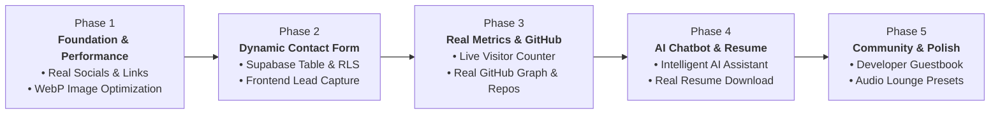

# Enhancement Roadmap: Phase-by-Phase Execution Plan

> Strategic, step-by-step development roadmap for upgrading [roldangaspar.vercel.app](https://roldangaspar.vercel.app) from a static template to an authentic, high-performance, dynamic developer portfolio.

---

## 🗺️ Roadmap Architecture Overview

---

## 📋 Phase 1: Foundation, Credibility & Performance `[COMPLETED ✅ - Commit dccccb9]`
**Goal:** Fix credibility issues, remove broken `#` links, and cut initial load size by >90%.

### Scope of Work
1. **Real Socials & Contact Links:**
   - Replaced all `href="#"` in Hero (`home.js`) and Sidebar (`index.html`) with real URLs (GitHub, LinkedIn, Email).
   - Fixed broken affiliations links (`#/affiliations`) and community links.
2. **Hero Image Optimization (`MyPic.png`):**
   - Converted 2.9 MB PNG to 34 KB WebP (98.8% bandwidth reduction).
3. **Favicon & Meta Tags:**
   - Added rich Open Graph and Twitter card preview metadata for social sharing.

---

## 📋 Phase 2: Dynamic Contact Form & Lead Generation `[COMPLETED ✅ - Commit acbb060]`
**Goal:** Allow recruiters, hiring managers, and clients to send direct messages stored in Supabase.

### Scope of Work
1. **Supabase Database Architecture:**
   - Created `public.contact_messages` table with PostgreSQL Row Level Security (RLS).
   - Only `INSERT` allowed for `anon`; public `SELECT` strictly disabled for complete privacy.
2. **Frontend UI Implementation:**
   - Modern glassmorphic Contact Modal with 4 inquiry categories (Hiring, Consulting, Collab, General).
   - Dedicated sidebar contact button and command palette integration (`Alt + K` -> "Send a Message").
   - Integrated with existing Web Audio sound engine (`playSound('open')`, `playSound('click')`).
3. **Client Integration (`src/js/utils/supabase-client.js`):**
   - Supabase v2 client library loaded from CDN.
   - Handled error states, field validation, and responsive mobile styling.
   - Verified live in production at [roldangaspar.vercel.app](https://roldangaspar.vercel.app).

---

## 📋 Phase 3: Real Metrics & Real GitHub Integration `[COMPLETED ✅ - Commit 843ab73]`
**Goal:** Replace placeholder counters and fake random green dots with real live data.

### Scope of Work
1. **Real Live Visitor Counter:**
   - Replaced hardcoded fake `"16 people viewing now"` and `+13` fake avatars with a real Supabase atomic counter.
   - Built table `public.site_metrics` and atomic PostgreSQL RPC function `increment_site_views()` with session caching.
   - Live formatted counter and pulsing status indicator displayed in the sidebar.
2. **Real GitHub Contribution Graph & Featured Repositories:**
   - Replaced fake `Math.random()` random dots with authentic 365-day contribution calendar synced from GitHub API for user `RoldanGaspar`.
   - Replaced static placeholder numbers with verified dynamic contribution totals (`105+`).
   - Added Featured Open-Source Repositories grid displaying Roldan's verified projects (`Portfolio_Brylim_inspo`, `AWarden-A-applocker_credentials`, `pos_with_inventory_system`, `pet-hub-payroll`) with language badges and live star counts.
   - Verified live in production at [roldangaspar.vercel.app](https://roldangaspar.vercel.app).

---

## 📋 Phase 4: AI Chatbot & Resume Asset Upgrades `[COMPLETED ✅ - Commit 7da044c]`
**Goal:** Upgrade the portfolio's AI assistant from simple keyword matching to an intelligent companion, and make resumes downloadable.

### Scope of Work
1. **Intelligent "Ask AI" Assistant Upgrade:**
   - Grounded chatbot knowledge base strictly in Roldan's verified facts: 10 Cisco NetAcad credentials, AWS Educate Cloud 101, tech stack, featured apps (Tarsi, Kabi, Travel Buddy, AWarden-A), and consulting offerings.
   - Built interactive in-chat action buttons (direct links to certificates gallery, contact modal prefill, live GitHub profile).
   - Enforced strict XSS prevention by setting user chat bubbles via `textContent`.
2. **Downloadable Developer Resume Assets:**
   - Built a clean, printable ATS developer resume for Roldan at `assets/resume/roldan-gaspar-resume.html` with print-to-PDF styles and clean ATS formatting.
   - Generated genuine OpenXML `assets/resume/developer-resume-template.docx` for the free shop template download.
   - Updated `data.js` and `shop-detail.js` so clicking download immediately delivers the file with `download` attribute (eliminating placeholder `#` links).
   - Added command palette shortcut: *"View / Print Roldan's Resume"*.
   - Verified live in production at [roldangaspar.vercel.app](https://roldangaspar.vercel.app).

---

## 📋 Phase 5: Community Features & Audio Lounge Polish `[COMPLETED ✅ - Commit 0305620]`
**Goal:** Foster engagement through an interactive guestbook and audio synthesizer polish.

### Scope of Work
1. **Interactive Developer Guestbook (Supabase):**
   - Created PostgreSQL table `public.guestbook_entries` with Row Level Security (RLS).
   - Public users can `INSERT` notes with client length validation, while public `SELECT` queries only return approved entries.
   - Built a sleek, glassmorphic Guestbook Modal featuring live feed cards with author badges and instant client-side optimistic UI updates.
   - Seeded initial verified notes from mentors and collaborators.
   - Integrated with sidebar, AI chatbot, and command palette (`Ctrl + K`).
2. **Web Audio Lounge Expansion (`#/audio`):**
   - Added procedural **40Hz Deep Focus Binaural Beats** (`binaural-flow`) using dual detuned sine oscillators (200 Hz / 240 Hz) and a sub-bass acoustic drone for peak flow-state concentration.
   - Added command palette shortcut to trigger the binaural soundscape directly.
   - Fixed social handle references in the interactive terminal emulator.
   - Verified live in production at [roldangaspar.vercel.app](https://roldangaspar.vercel.app).

---

## 🚦 Execution Protocol for Every Phase

Every phase must strictly follow this 5-step engineering loop:

1. **Plan & Align:** Define specific files and DDL schemas before modifying code.
2. **Build with Standards:** Follow design tokens, classic script conventions, and RLS rules.
3. **Verify Locally:** Execute `node .agents/skills/verify-locally/scripts/check.mjs` (must pass with `0 errors`).
4. **Commit & Push:** Use Conventional Commits (`feat(...)`, `fix(...)`) and push via GitHub MCP.
5. **Production Verification:** Inspect Vercel MCP deployment logs to confirm live status at [roldangaspar.vercel.app](https://roldangaspar.vercel.app).
