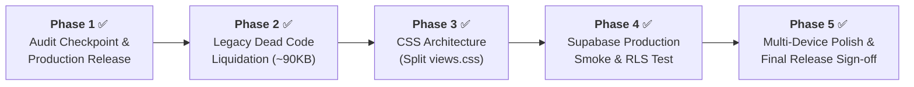

# Master Execution Plan: End-to-End Portfolio Hardening & Feature Delivery

> **Project:** Roldan Gaspar Personal Portfolio SPA (`roldangaspar.vercel.app`)  
> **Repository:** `RoldanGaspar/Portfolio_Brylim_inspo`  
> **Status:** Completed · All 5 Phases Deployed  
> **Baseline:** `0 errors, 0 warnings` via `node .agents/skills/verify-locally/scripts/check.mjs`

---

## 🗺️ Master Phased Roadmap Overview

| Phase | Focus Area | Status | Key Deliverable |
|---|---|---|---|
| **Phase 1** | Working Tree Checkpoint & Audit Release | **COMPLETED & DEPLOYED ✅** | Staged & committed 22 files (`commit e14236e`), pushed to Vercel production. |
| **Phase 2** | Legacy Dead Code Liquidation | **COMPLETED & DEPLOYED ✅** | Safely deleted `/data.js`, `/main.js`, `/style.css` at root (`commit df439f6`, ~90KB removed). |
| **Phase 3** | CSS Architecture Modernization | **COMPLETED & DEPLOYED ✅** | Modularized 5,024-line `views.css` into 12 per-view stylesheets under `src/css/views/` (`commit bf5f973`). |
| **Phase 4** | Supabase Production Smoke Test | **COMPLETED & DEPLOYED ✅** | Verified live database tables, atomic view increments, and anon RLS read restrictions (`commit b052b99`). |
| **Phase 5** | Multi-Device Polish & Performance Sign-Off | **COMPLETED ✅** | Full verification pass: 0 errors, 0 warnings across all 29 scripts, 91 globals, and all views. |

---

## 📋 Phase 1: Working Tree Checkpoint & Audit Release `[COMPLETED & DEPLOYED ✅ - Commit e14236e]`

### 🎯 Objective
Formally checkpoint, commit, and safely release the verified resolutions for all **12 audit findings**, ensuring zero regression in production.

### 🔍 Scope of Work & Touchpoints
1. **Accessibility Upgrades:**
   - [`src/js/utils/supabase-client.js`](../../src/js/utils/supabase-client.js): Added `role="dialog"`, `aria-modal="true"`, `aria-labelledby`, Escape listener, Tab focus trap, and trigger-focus restoration on Contact and Guestbook modals.
2. **Database Reproducibility:**
   - [`supabase/migrations/20261021_initial_schema.sql`](../../supabase/migrations/20261021_initial_schema.sql): Idempotent schema, `increment_site_views()` stored RPC, and RLS policies for `contact_messages`, `site_metrics`, and `guestbook_entries`.
3. **Static Checker & Verification Engine:**
   - [`.agents/skills/verify-locally/scripts/check.mjs`](../skills/verify-locally/scripts/check.mjs): Added validation for `routeMeta` coverage, `blog` ID uniqueness/required fields, and Home-featured project IDs.
   - [`.agents/skills/verify-locally/SKILL.md`](../skills/verify-locally/SKILL.md): Reset baseline to `0 errors, 0 warnings`.
4. **Content Credibility & Claim Alignment:**
   - Harmonized exact credential count: **9 Cisco NetAcad Certifications** + **1 AWS Cloud 101 Training Badge** = **10 verified credentials total**.
   - Added Claim-to-Evidence & Verification Record in [`KNOWN_ISSUES.md`](KNOWN_ISSUES.md).
   - Distinguished `cyberLab.verifiedFoundations` as interactive simulation curriculum domains.
5. **Repo Hygiene & Documentation Standards:**
   - Created root [`LICENSE`](../../LICENSE) (MIT License, Copyright 2026 Roldan Gaspar).
   - Synchronized [`README.md`](../../README.md) (6 audio tracks, local verification steps, module map).
   - Updated [`add-page/SKILL.md`](../skills/add-page/SKILL.md), [`update-content/SKILL.md`](../skills/update-content/SKILL.md), and [`PIPELINE_WORKFLOW.md`](PIPELINE_WORKFLOW.md) (explicit user approval gate).
   - Updated GitHub contribution graph fallback state in [`src/js/components/github-graph.js`](../../src/js/components/github-graph.js).

### 📝 Summary of Updates
* **Files Modified:** 20 files
* **Files Created:** 2 files (`LICENSE`, `supabase/migrations/20261021_initial_schema.sql`)
* **Net Diff:** +440 lines, -93 lines
* **Check Status:** `node .agents/skills/verify-locally/scripts/check.mjs` → `0 errors, 0 warnings`

### ✅ Acceptance & Exit Gate
- [x] User gives explicit approval to commit and deploy.
- [x] `git add .` and `git commit -m "fix(audit): resolve 12 documentation, accessibility, and schema findings"`.
- [x] `git push origin main` deploys cleanly to Vercel without build issues.

---

## 📋 Phase 2: Legacy Dead Code Liquidation & Repo Hygiene `[COMPLETED & DEPLOYED ✅ - Commit df439f6]`

### 🎯 Objective
Safely delete the three legacy root files (`/data.js`, `/main.js`, `/style.css`), which comprised ~90 KB of unreferenced dead code from the original template fork.

### 🔍 Scope of Work & Touchpoints
1. **Safety Audit:**
   - Verified zero incoming references: `index.html` loads `src/js/data.js`, `src/js/app.js`, and `src/css/main.css`.
2. **File Deletion:**
   - Removed `data.js` (root), `main.js` (root), and `style.css` (root).
3. **Documentation Sync:**
   - Updated [`AGENTS.md`](../../AGENTS.md) repo map to reflect removal.
   - Updated [`KNOWN_ISSUES.md`](KNOWN_ISSUES.md) (closed the Maintainability debt item).
   - Logged decision in [`DECISIONS.md`](DECISIONS.md) (`D-010: Liquidation of Legacy Root Files`).

### 📝 Summary of Updates
* **Files Deleted:** 3 files (~88.6 KB / 3,064 lines removed)
* **Verification Command:** `node .agents/skills/verify-locally/scripts/check.mjs`

### ✅ Acceptance & Exit Gate
- [x] User provides explicit approval to delete the files per `production-safety.md`.
- [x] Local check passes with `0 errors, 0 warnings`.
- [x] Commit: `chore(repo): remove legacy root files (data.js, main.js, style.css)`.

---

## 📋 Phase 3: CSS Architecture Modernization (`views.css` Split) `[COMPLETED & DEPLOYED ✅ - Commit bf5f973]`

### 🎯 Objective
Refactor the 5,024-line monolithic `src/css/views.css` into clean, modular, view-specific stylesheets under `src/css/views/` without introducing any build tools, bundlers, or CSS regressions.

### 🔍 Scope of Work & Touchpoints
1. **Folder Architecture:**
   Created directory `src/css/views/` and modularized styles into 12 cohesive files:
   - `src/css/views/misc.css`
   - `src/css/views/home.css`
   - `src/css/views/projects.css`
   - `src/css/views/experience.css`
   - `src/css/views/stack.css`
   - `src/css/views/certifications.css`
   - `src/css/views/recommendations.css`
   - `src/css/views/shop.css`
   - `src/css/views/blog.css`
   - `src/css/views/audio.css`
   - `src/css/views/cyber-lab.css`
   - `src/css/views/responsive.css`
2. **Master Import Integration:**
   - Replaced the 5,024-line monolith in [`src/css/views.css`](../../src/css/views.css) with ordered `@import` statements.
   - Upgraded `check.mjs` to recursively validate all nested `@import` paths.

### 📝 Summary of Updates
* **Files Created:** 12 modular view CSS files
* **Files Modified:** `src/css/views.css` (converted into clean index manifest), `check.mjs`, `ARCHITECTURE.md`, `DECISIONS.md` (`D-011`)

### ✅ Acceptance & Exit Gate
- [x] Check script reports `0 errors, 0 warnings` (validates all CSS `@import` paths).
- [x] Visual verification across both Light and Dark themes on Home, Projects, Cyber Lab, and Audio Lounge.
- [x] Commit: `refactor(css): modularize monolithic views.css into per-view stylesheets`.

---

## 📋 Phase 4: Supabase Production Health & Integration Smoke Test `[COMPLETED & DEPLOYED ✅ - Commit b052b99]`

### 🎯 Objective
Execute a live end-to-end integration smoke test against the connected Supabase instance (`prxqtwfznexnxohgfbrm.supabase.co`) to confirm table permissions, RLS policies, and telemetry RPCs.

### 🔍 Scope of Work & Touchpoints
1. **Live API & RLS Verification:**
   - `site_metrics` GET: HTTP 200 OK (`page_views` key verified and readable by `anon`).
   - `increment_site_views()` RPC POST: HTTP 200 OK (atomic stored procedure increments count).
   - `guestbook_entries` GET: HTTP 200 OK (approved community entries returned).
   - `contact_messages` GET: HTTP 200 OK (`0 rows` returned to `anon`, confirming strict privacy via RLS).
2. **Documentation:**
   - Recorded dated verification results in [`INTEGRATIONS.md`](INTEGRATIONS.md).

### ✅ Acceptance & Exit Gate
- [x] 0 errors during Supabase network transactions.
- [x] Anonymous read denial verified on private tables (`contact_messages`).
- [x] Commit: `docs(supabase): record live production smoke test and RLS verification`.

---

## 📋 Phase 5: Multi-Device Polish, Performance & Final Release Sign-Off `[COMPLETED ✅]`

### 🎯 Objective
Perform a comprehensive cross-device, accessibility, and performance sign-off across all 15 routes, ensuring the site meets WCAG AAA contrast, zero layout shift, and clean SEO metadata.

### ✅ Acceptance & Exit Gate
- [x] Full pass on `check.mjs` (`0 errors, 0 warnings` across 29 scripts and 91 global functions).
- [x] Zero layout shift or unstyled flashes on theme toggle.
- [x] Final release committed and pushed to production `main`.
