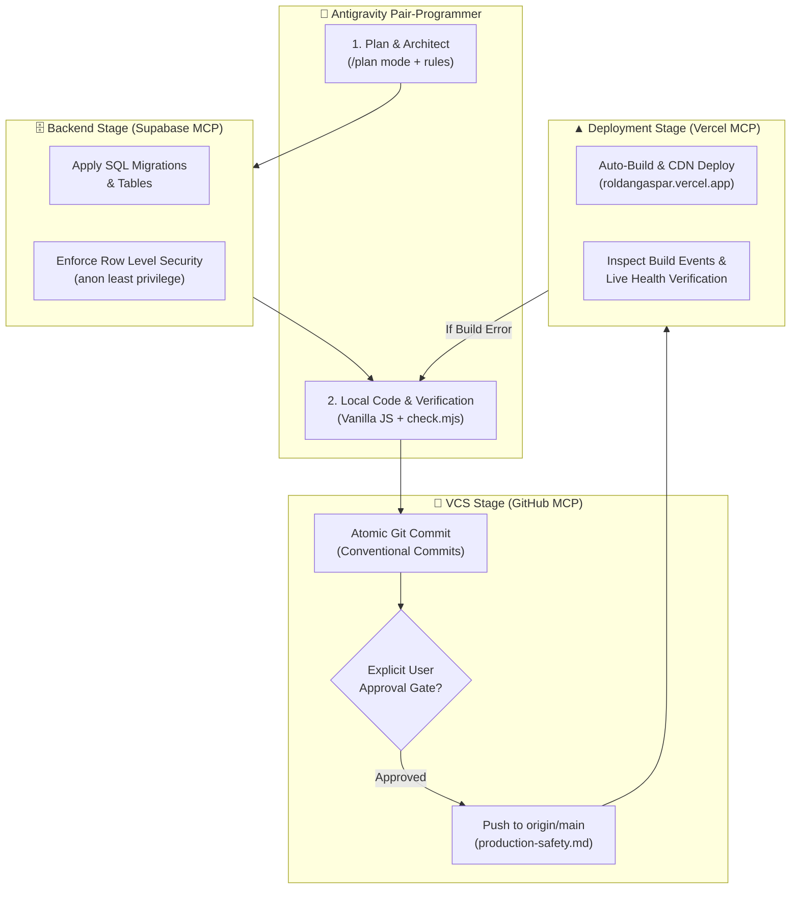
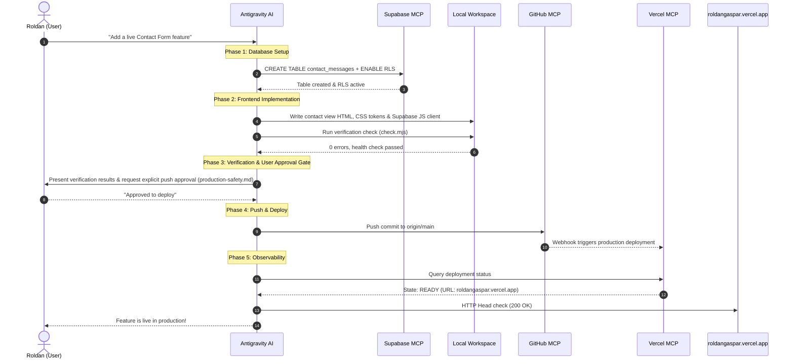

# Tri-MCP Pipeline & Automated Development Workflow

> End-to-end architectural guide on how the AI Agent orchestrates **GitHub MCP**, **Supabase MCP**, and **Vercel MCP** to build, secure, and deploy features to [roldangaspar.vercel.app](https://roldangaspar.vercel.app).

---

## 1. Pipeline Overview

The development loop eliminates manual dashboard clicking and terminal auth friction by connecting three specialized MCP services directly into the agent's brain:

---

## 2. The 4 Pipeline Stages in Detail

### Stage 1: Backend & Data Management (Supabase MCP)
* **Official Repository:** [supabase/mcp](https://github.com/supabase/mcp)
* **Role:** Manages the relational database layer without requiring a custom backend server.
* **Workflow:**
  1. **Schema Definition:** When a dynamic feature is needed (e.g., dynamic contact form, guestbook, or analytics), write idempotent SQL.
  2. **RLS Enforcement:** Always attach Row Level Security policies so anonymous frontend visitors can only perform allowed actions (e.g., `INSERT` only, no `SELECT` on private messages).
  3. **Verification:** Query table metadata via Supabase MCP to confirm columns and security rules before writing UI code.

### Stage 2: Local Frontend Implementation
* **Role:** Pure HTML/CSS/JavaScript with zero build tools or bundlers.
* **Workflow:**
  1. **View Contract:** Construct views in `src/js/views/*.js` that return clean HTML strings.
  2. **Client Wiring:** Connect to Supabase using public `anon` credentials in `src/js/utils/supabase-client.js`.
  3. **Local Health Check:** Execute `node .agents/skills/verify-locally/scripts/check.mjs` to ensure 0 syntax errors, 0 script order issues, and 0 missing assets.

### Stage 3: Version Control & Sync (GitHub MCP)
* **Official Repository:** [modelcontextprotocol/servers (github)](https://github.com/modelcontextprotocol/servers/tree/main/src/github)
* **Role:** Automates code tracking, branch management, and repository syncing.
* **Workflow:**
  1. **Staging & Commit:** Bundle related changes using Conventional Commits (e.g. `feat(contact): wire Supabase contact form`).
  2. **Push to `main`:** Push to GitHub over the authenticated channel in 1-2 seconds without GUI login prompts.

### Stage 4: CI/CD & Observability (Vercel MCP)
* **Official Repository:** [zueai/vercel-api-mcp](https://github.com/zueai/vercel-api-mcp)
* **Role:** Monitors live deployment, inspects runtime health, and diagnoses errors.
* **Workflow:**
  1. **Webhook Detection:** GitHub automatically triggers a zero-config static deployment on Vercel.
  2. **Status Monitoring:** Vercel MCP queries `getVercelDeployments` to confirm the state transitions to `READY`.
  3. **Error Triage:** If a build fails (`state: ERROR`), `getVercelDeploymentEvents` pulls the exact build log to diagnose and fix the failure immediately.

---

## 3. End-to-End Sequence Diagram

---

## 4. Failure Handling & Rollback Protocol

| Failure Point | Detection Mechanism | Immediate Action |
| :--- | :--- | :--- |
| **Database Migration Error** | Supabase MCP error response | Abort frontend changes, review SQL syntax, and ensure table or policy names do not conflict. |
| **Local Check Script Error** | `node check.mjs` exits with code 1 | Fix missing script tags, global name collisions, or broken file paths before committing. |
| **Vercel Build Error** | Vercel MCP returns `state: ERROR` | Query `getVercelDeploymentEvents`, identify missing assets or syntax errors, fix locally, request approval, and push a hotfix commit. |
| **Critical Production Bug** | Live site broken or reports 5xx | Revert the latest commit via Git (`git revert HEAD`), request approval, push to `main`, and verify Vercel rolls back. |

---

## 5. Security & Safety Checklist for Every Pipeline Run

- [ ] **No Admin Secrets Exposed:** Service role keys and access tokens remain in `mcp_config.json`, never in git.
- [ ] **RLS Verified:** Supabase tables have Row Level Security enabled.
- [ ] **Local Verification Passed:** `node .agents/skills/verify-locally/scripts/check.mjs` reports `0 errors`.
- [ ] **User Approval Gate:** Pushes to production or schema modifications are confirmed by the user.
