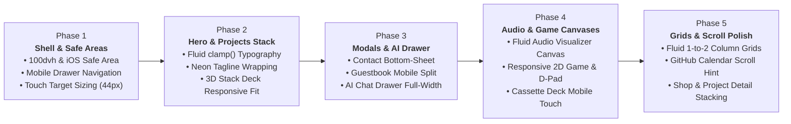

# Responsiveness Roadmap: Multi-Device & Mobile Optimization Plan

> Step-by-step engineering roadmap for optimizing [roldangaspar.vercel.app](https://roldangaspar.vercel.app) across all mobile devices (320px–480px), tablets (768px–1024px), and desktops (1200px+).

---

## 🗺️ Roadmap Architecture Overview

---

## 📋 Phase 1: App Shell, Mobile Drawer & Safe Areas `[COMPLETED ✅ - Commit e55b3fc]`
**Goal:** Perfect the core mobile frame, prevent content clipping under browser toolbars/home indicators, and ensure accessible touch targets.

### Scope of Work
1. **Dynamic Viewport & Safe Area Tokens (`tokens.css`):**
   - Defined `--safe-top`, `--safe-bottom`, `--safe-left`, and `--safe-right` using standard `env(...)` insets.
   - Upgraded mobile header to account for top notch/Dynamic Island (`height: calc(60px + var(--safe-top))`).
   - Upgraded mobile drawer height to `calc(100dvh - 60px - var(--safe-top))` with bottom safe area padding `calc(28px + var(--safe-bottom))` so theme and contact buttons are never clipped.
2. **Smooth Drawer Scrolling & Momentum:**
   - Added `-webkit-overflow-scrolling: touch;` and `overscroll-behavior: contain;` for buttery smooth mobile scrolling.
   - Upgraded backdrop blur to `blur(24px)`.
3. **Touch Targets (44px WCAG Guideline):**
   - Configured `#mobile-menu-toggle`, `.theme-btn`, `.sound-btn`, `.sidebar-contact-btn`, and navigation links with minimum 44x44px touch targets.
   - Verified live in production at [roldangaspar.vercel.app](https://roldangaspar.vercel.app).

---

## 📋 Phase 2: Hero Section, Neon Badges & Projects Stack `[COMPLETED ✅ - Commit 417f20b]`
**Goal:** Ensure the portfolio homepage looks crisp, proportional, and unclipped on narrow mobile viewports (320px–400px).

### Scope of Work
1. **Fluid Hero Typography & Image:**
   - Implemented CSS `clamp(1.6rem, 5vw, 2.5rem)` for `.hero-title` and `clamp(1.6rem, 4.5vw, 2.5rem)` for `.page-header h2`.
   - Scaled `.hero-image-container` fluidly with `max-width: 75vw` and `aspect-ratio: 22/25` for narrow displays.
2. **Neon Badge Wrapping:**
   - Perfected `.hero-neon-tagline` wrapping with centered alignment and tight 6px–8px gap on mobile.
3. **Projects Stack Deck Mobile Fit & Touch Gestures:**
   - Reduced side card horizontal displacement (`translateX(-32px)` / `translateX(32px)` at 480px; `translateX(-18px)` / `translateX(18px)` at 380px) to completely eliminate horizontal viewport overflow.
   - Added passive touch listeners (`touchstart`, `touchend`) to `#projects-stack-deck` supporting natural mobile swipe gestures to rotate cards with sound feedback.
   - Rendered animated `.projects-stack-hint` below deck guiding mobile visitors to swipe or tap cards.

---

## 📋 Phase 3: Interactive Modals & AI Chatbot Drawer `[COMPLETED ✅ - Commit 14e7e43]`
**Goal:** Transform desktop-centric popups into natural mobile bottom-sheets and responsive overlay panels.

### Scope of Work
1. **Contact Modal & Guestbook Modal Mobile Bottom-Sheet:**
   - On screens `≤ 600px`, anchored `.contact-modal-card` and `.guestbook-modal-card` to the bottom with rounded top corners (`border-radius: 20px 20px 0 0`), drag handle indicators, and `max-height: calc(90dvh - var(--safe-top))`.
   - Added bottom safe area padding (`calc(24px + var(--safe-bottom))`) and momentum touch scrolling.
2. **AI Chatbot Drawer Responsiveness:**
   - On screens `≤ 480px`, converted `.ai-chat-drawer` into a fixed slide-up sheet (`100vw` wide, `85dvh` height, drag handle indicator, safe area bottom padding on footer input).
   - Added dismiss-on-outside-click listener in `ai-bot.js` for seamless closing.
   - Enforced 16px font size on `#ai-user-input` to prevent iOS Safari auto-zoom.
3. **Terminal & Typing Modals:**
   - Reduced `.modal-content-area` padding to `18px 12px` and scaled `.terminal-modal h2` using `clamp(1.4rem, 5vw, 2.2rem)`.

---

## 📋 Phase 4: Audio Studio & 2D Mini-Game Canvas Scaling
**Goal:** Ensure canvas-driven experiences resize fluidly without horizontal overflow or pixel distortion.

### Scope of Work
1. **Responsive Audio Visualizer Canvas (`#/audio`):**
   - Make `#audio-visualizer-canvas` fluidly fill the tape bridge width (`width: 100%`) rather than fixed 340px.
   - Polish mobile layout of the Hi-Fi cassette deck, Pomodoro widget, and volume slider.
2. **2D Dev Lounge Canvas Scaling:**
   - In `modals.js`, dynamically calculate `#game-canvas` width based on viewport width (`Math.min(600, window.innerWidth - 40)`).
   - Ensure the mobile on-screen D-pad is comfortably reachable with thumbs.

---

## 📋 Phase 5: Content Grids, Detail Views & GitHub Scroll Hint
**Goal:** Refine all multi-card galleries, detail pages, and horizontal overflow sections.

### Scope of Work
1. **Fluid Gallery Grids:**
   - Update `.certs-full-grid`, `.shop-grid`, `.recs-full-grid`, `.gear-grid`, `.consulting-grid` to smoothly adapt from 3 columns (desktop) to 2 columns (tablet) and 1 column (mobile).
2. **GitHub Contribution Calendar Mobile Indicator:**
   - Add a subtle horizontal scroll hint with gradient fade indicator on `.github-graph-container` so mobile users know they can swipe through the 52 weeks.
3. **Shop & Project Detail Stacking:**
   - Ensure sticky meta sidebars in `#/projects/:id` and `#/shop/:id` un-stick and stack gracefully above/below the main content on mobile screens.

---

## 🚦 Execution Protocol
1. **Plan & Report:** Formulate exact file diffs before making changes.
2. **Await Approval:** Strict chain of user approval (`"APPROVED"`) before each phase is executed.
3. **Verify Locally:** `node .agents/skills/verify-locally/scripts/check.mjs` must pass with `0 errors`.
4. **Deploy & Verify:** Commit, push to `main`, and verify on [roldangaspar.vercel.app](https://roldangaspar.vercel.app).
