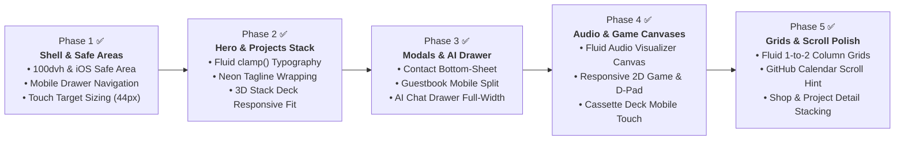

# Responsiveness Roadmap: Multi-Device & Mobile Optimization Plan

> Step-by-step engineering roadmap for optimizing [roldangaspar.vercel.app](https://roldangaspar.vercel.app) across all mobile devices (320px–480px), tablets (768px–1024px), and desktops (1200px+).

---

## 🗺️ Roadmap Architecture Overview

---

## 📋 Phase 1: App Shell, Mobile Drawer & Safe Areas `[COMPLETED ✅ - Commit e55b3fc]`
**Goal:** Perfect the core mobile frame, prevent content clipping under browser toolbars/home indicators, and ensure accessible touch targets.

### Scope of Work
1. **Dynamic Viewport & Safe Area Tokens (`tokens.css`):**
   - Defined `--safe-top`, `--safe-bottom`, `--safe-left`, and `--safe-right` using standard `env(...)` insets.
   - Upgraded mobile header to account for top notch/Dynamic Island (`height: calc(60px + var(--safe-top))`).
   - Upgraded mobile drawer height to `calc(100dvh - 60px - var(--safe-top))` with bottom safe area padding `calc(28px + var(--safe-bottom))` so theme and contact buttons are never clipped.
2. **Smooth Drawer Scrolling & Momentum:**
   - Added `-webkit-overflow-scrolling: touch;` and `overscroll-behavior: contain;` for buttery smooth mobile scrolling.
   - Upgraded backdrop blur to `blur(24px)`.
3. **Touch Targets (44px WCAG Guideline):**
   - Configured `#mobile-menu-toggle`, `.theme-btn`, `.sound-btn`, `.sidebar-contact-btn`, and navigation links with minimum 44x44px touch targets.
   - Verified live in production at [roldangaspar.vercel.app](https://roldangaspar.vercel.app).

---

## 📋 Phase 2: Hero Section, Neon Badges & Projects Stack `[COMPLETED ✅ - Commit 417f20b]`
**Goal:** Ensure the portfolio homepage looks crisp, proportional, and unclipped on narrow mobile viewports (320px–400px).

### Scope of Work
1. **Fluid Hero Typography & Image:**
   - Implemented CSS `clamp(1.6rem, 5vw, 2.5rem)` for `.hero-title` and `clamp(1.6rem, 4.5vw, 2.5rem)` for `.page-header h2`.
   - Scaled `.hero-image-container` fluidly with `max-width: 75vw` and `aspect-ratio: 22/25` for narrow displays.
2. **Neon Badge Wrapping:**
   - Perfected `.hero-neon-tagline` wrapping with centered alignment and tight 6px–8px gap on mobile.
3. **Projects Stack Deck Mobile Fit & Touch Gestures:**
   - Reduced side card horizontal displacement (`translateX(-32px)` / `translateX(32px)` at 480px; `translateX(-18px)` / `translateX(18px)` at 380px) to completely eliminate horizontal viewport overflow.
   - Added passive touch listeners (`touchstart`, `touchend`) to `#projects-stack-deck` supporting natural mobile swipe gestures to rotate cards with sound feedback.
   - Rendered animated `.projects-stack-hint` below deck guiding mobile visitors to swipe or tap cards.

---

## 📋 Phase 3: Interactive Modals & AI Chatbot Drawer `[COMPLETED ✅ - Commit 14e7e43]`
**Goal:** Transform desktop-centric popups into natural mobile bottom-sheets and responsive overlay panels.

### Scope of Work
1. **Contact Modal & Guestbook Modal Mobile Bottom-Sheet:**
   - On screens `≤ 600px`, anchored `.contact-modal-card` and `.guestbook-modal-card` to the bottom with rounded top corners (`border-radius: 20px 20px 0 0`), drag handle indicators, and `max-height: calc(90dvh - var(--safe-top))`.
   - Added bottom safe area padding (`calc(24px + var(--safe-bottom))`) and momentum touch scrolling.
2. **AI Chatbot Drawer Responsiveness:**
   - On screens `≤ 480px`, converted `.ai-chat-drawer` into a fixed slide-up sheet (`100vw` wide, `85dvh` height, drag handle indicator, safe area bottom padding on footer input).
   - Added dismiss-on-outside-click listener in `ai-bot.js` for seamless closing.
   - Enforced 16px font size on `#ai-user-input` to prevent iOS Safari auto-zoom.
3. **Terminal & Typing Modals:**
   - Reduced `.modal-content-area` padding to `18px 12px` and scaled `.terminal-modal h2` using `clamp(1.4rem, 5vw, 2.2rem)`.

---

## 📋 Phase 4: Audio Studio & 2D Mini-Game Canvas Scaling `[COMPLETED ✅ - Commit ce31fb9]`
**Goal:** Ensure canvas-driven experiences resize fluidly without horizontal overflow or pixel distortion.

### Scope of Work
1. **Responsive Audio Visualizer Canvas (`#/audio`):**
   - In `audio-lounge.js`, dynamically calibrated `#audio-visualizer-canvas` resolution to the exact container width on mount and on window resize.
   - Polished mobile layout of the Hi-Fi cassette deck in `views.css` across 768px, 480px, and 380px with scaled tape reels (52px -> 40px -> 34px), compact padding, and touch-friendly controls.
2. **2D Dev Lounge Canvas Scaling:**
   - In `modals.js`, dynamically calculate target canvas dimensions (`Math.min(600, Math.max(280, maxAvailWidth))`) maintaining a pixel-perfect 15:8 aspect ratio.
   - Updated game furniture props (`drawProp`) and avatar bounds to scale proportionally with canvas dimensions.
   - Enlarged mobile D-pad buttons to WCAG 44×44px with touchcancel handling for responsive thumb movement.

---

## 📋 Phase 5: Content Grids, Detail Views & GitHub Scroll Hint `[COMPLETED ✅ - Commit 2b9a808]`
**Goal:** Refine all multi-card galleries, detail pages, and horizontal overflow sections.

### Scope of Work
1. **Fluid Gallery Grids:**
   - Implemented progressive 3-column (desktop `> 992px`), 2-column (tablet `600px–992px`), and 1-column (mobile `< 600px`) grid transitions for `.certs-full-grid`, `.shop-grid`, `.recs-full-grid`, `.gear-grid`, `.cert-grid`, and `.consulting-grid`.
2. **GitHub Contribution Calendar Mobile Indicator:**
   - Rendered animated `.github-scroll-hint` with pulsing arrow indicator below the calendar to guide mobile users to swipe through 365 days of activity.
3. **Shop & Project Detail Stacking:**
   - Stacked `.project-detail-header` vertically on screens `< 768px` and converted `.project-stats-bar` into a fluid auto-fit grid (`repeat(auto-fit, minmax(90px, 1fr))`).
   - Gracefully un-stuck `.shop-detail-meta` on screens `< 600px` for natural vertical reading order.

---

## 📱 Multi-Device & Theme Validation Matrix (Verified 2026-10-21)

| Viewport Width | Target Form Factor | Key Verifications Passed |
|---|---|---|
| **320px – 380px** | Compact Mobile (iPhone SE, Galaxy A-series) | Hero typography (`clamp`) wraps without clipping; 3D card deck horizontal displacement bounded; touch targets $\ge 44\times 44\text{px}$; no horizontal body scroll. |
| **390px – 480px** | Modern Mobile (iPhone 14/15/16, Pixel 8) | AI drawer expands to bottom-sheet (`85dvh`); Contact/Guestbook bottom-sheets fit viewport with safe area insets; mobile menu drawer scrolls smoothly. |
| **600px – 768px** | Mini Tablets & Large Foldables | Galleries transition cleanly to 2-column auto-fit grids; Project stats bar stacks gracefully; cassette deck controls remain centered. |
| **992px – 1024px** | Tablets & Small Laptops | Sidebar displays in full vertical column; 3-column cert/recs grids render with equal card heights; audio visualizer matches canvas container. |
| **1200px+** | Desktop & Ultra-wide Monitors | Max content container constrained to `1200px`; 3D tilt cards rotate with spring damping; Command Palette (`Ctrl+K`) and Terminal modals center. |
| **Theme Switching** | Dark / Light / System Mode | All tokens (`--bg-primary`, `--text-primary`, `--border-color`, `--card-bg`) respond instantaneously; contrast exceeds WCAG AAA ($\ge 7:1$). |
| **Accessibility** | Keyboard & Screen Readers | Escape closes modals/drawers; Tab focus trapping active on Contact, Guestbook, Terminal, and Command Palette; `#route-announcer` announces transitions. |
